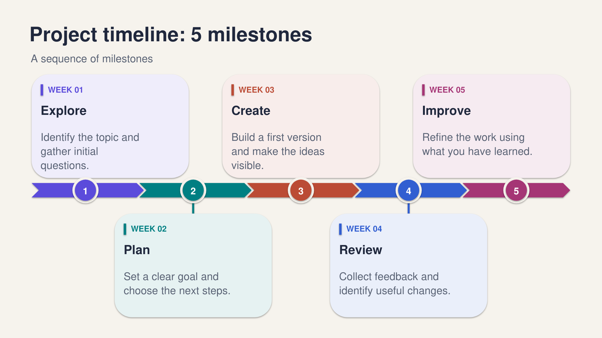

# Editable Timeline

A horizontal milestone timeline built entirely with editable PowerPoint shapes and text.

## Included layouts

The ready-to-use PowerPoint includes:

- 3-milestone timeline
- 4-milestone timeline
- 5-milestone timeline
- 6-milestone timeline
- Optional cover slide



## Download

[Download the editable PowerPoint](../../exports/01_editable_timeline/timeline_examples.pptx)

PNG previews are available in:

`exports/01_editable_timeline/png/`

## Generate the PowerPoint

Run this command from the repository root:

```bash
python 01_editable_timeline.py
```

The default command creates a cover followed by four timeline examples with 3, 4, 5, and 6 milestones.

The generated PowerPoint is saved to:

`exports/01_editable_timeline/timeline_examples.pptx`

## Customize the timeline

You can edit `ITEMS` and `SETTINGS` near the top of `01_editable_timeline.py`.

- `ITEMS` controls milestone labels, titles, descriptions, and ordering.
- `SETTINGS` controls the slide title, subtitle, font, background, text colors, and palette.
- `SUBSTACK_URL` controls the link used on the optional cover slide.

For a single timeline using the current `ITEMS`, run:

```bash
python 01_editable_timeline.py --single
```

You can also supply custom content from the included JSON example:

```bash
python 01_editable_timeline.py --input templates/01_editable_timeline/example.json
```

To omit the cover:

```bash
python 01_editable_timeline.py --no-cover
```

To choose another output filename:

```bash
python 01_editable_timeline.py --input templates/01_editable_timeline/example.json --no-cover --output my_timeline.pptx
```

## Editing notes

The PowerPoint contains real shapes and text boxes, not a flattened screenshot. Colors, labels, cards, timeline elements, and numbers can be edited separately.

The automatic layout is calculated when the Python script runs. If you add or remove milestones directly in PowerPoint, you will need to reposition the objects manually.

This template supports 3 to 6 milestones.

Milestones use equal spacing rather than a proportional date scale, so the template is not intended to show unequal time intervals to scale.

The script uses conservative text-length limits to reduce overflow. If you change the font or add longer text, check the slides after generating them.

PNG files are static previews and are not editable as individual PowerPoint shapes.

## Source files

- `01_editable_timeline.py` — PowerPoint generator
- `templates/01_editable_timeline/example.json` — example custom content
- `exports/01_editable_timeline/timeline_examples.pptx` — ready-to-use PowerPoint
- `exports/01_editable_timeline/png/` — preview images
